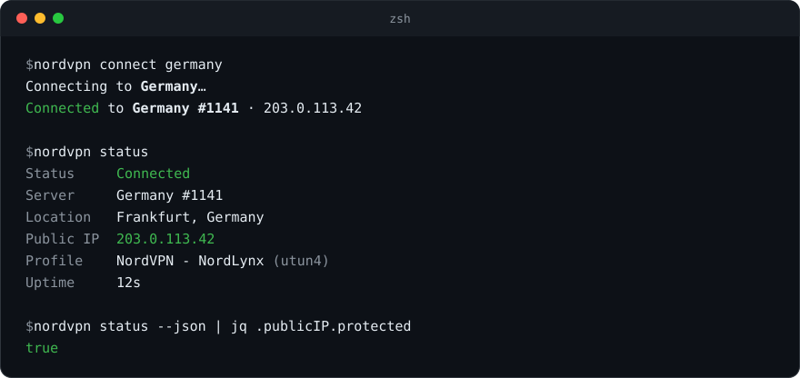
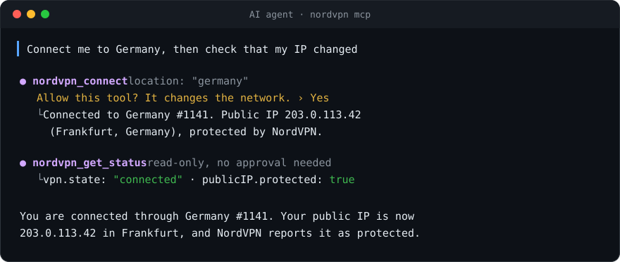

<div align="center">

# nordvpn-cli

**Control the NordVPN Mac app from your terminal, your scripts and your AI agents.**

[](https://github.com/d4ms3c/nordvpn-cli/actions/workflows/ci.yml)


[](docs/mcp.md)
[](LICENSE)



</div>

An unofficial command-line companion for the NordVPN macOS app. Connect, disconnect and inspect your VPN from scripts, terminal shortcuts and AI coding agents such as Claude Code, Codex and Cursor.

It does not replace the app, it drives it: your account, protocol, kill switch and auto-connect settings stay in NordVPN.app.

> **Unofficial.** This project is not affiliated with, endorsed by or supported by NordVPN or Nord Security. "NordVPN" is a trademark of its respective owner.

## Highlights

- **One command per task:** `nordvpn connect italy`, `nordvpn status`, `nordvpn disconnect`. Countries can be codes, names or cities.
- **Verified connections:** `connect` waits until the tunnel is up and NordVPN reports your public IP as protected, in the country you asked for.
- **Made for scripts:** `--json` output, documented exit codes, shell completions for zsh, bash and fish.
- **Built-in MCP server:** `nordvpn mcp` lets AI agents check the VPN and, with your approval, connect or disconnect. Same binary, no Node.js or Python.
- **Nothing new to trust:** no extra VPN credentials, configuration files or telemetry. A single Swift binary.

## Quick look

```sh
nordvpn connect italy       # ask your existing app to connect
nordvpn status              # tunnel state, server, public IP and uptime
nordvpn disconnect          # requires Accessibility and English app menus
nordvpn doctor              # diagnose setup without changing the connection
```

## Requirements

- macOS 13 or later
- [NordVPN for macOS](https://nordvpn.com/download/mac/), signed in and connected at least once
- Swift 6 (Xcode 16 or the Command Line Tools) to build

## Install

### From source (available now)

```sh
git clone https://github.com/d4ms3c/nordvpn-cli.git
cd nordvpn-cli
make install                  # release build into ~/.local/bin/nordvpn
make install PREFIX=/usr/local
```

Ensure `~/.local/bin` is on your `PATH` when using the default prefix.

### Release binaries and Homebrew

The release workflow prepares Apple Silicon and Intel archives, checksums and a Homebrew formula. They become available only after a maintainer publishes a release and adds its generated formula to a tap. Until then, use the source installation above. See the [release checklist](docs/releasing.md).

### Shell completion

For zsh:

```sh
mkdir -p ~/.zfunc
nordvpn --generate-completion-script zsh > ~/.zfunc/_nordvpn
```

Add `fpath=(~/.zfunc $fpath)` before `autoload -Uz compinit; compinit` in your `.zshrc`. Completion generation also supports `bash` and `fish`.

## Use it from AI agents (MCP)

`nordvpn mcp` is a [Model Context Protocol](https://modelcontextprotocol.io) server inside the CLI. Your agent gets four read-only tools (status, countries, servers, doctor) and two that change the network (connect, disconnect), which clients ask you to approve.



```sh
claude mcp add --scope user nordvpn -- nordvpn mcp   # Claude Code
codex mcp add nordvpn -- nordvpn mcp                 # Codex CLI, IDE extension and app
```

[](https://cursor.com/en/install-mcp?name=nordvpn&config=eyJjb21tYW5kIjoibm9yZHZwbiIsImFyZ3MiOlsibWNwIl19)
[](https://insiders.vscode.dev/redirect?url=vscode%3Amcp%2Finstall%3F%257B%2522name%2522%253A%2522nordvpn%2522%252C%2522command%2522%253A%2522nordvpn%2522%252C%2522args%2522%253A%255B%2522mcp%2522%255D%257D)

`nordvpn mcp --read-only` leaves out connect and disconnect. Setup for Windsurf, Antigravity and Claude Desktop, approval settings and safety notes are in the [MCP guide](docs/mcp.md).

## Usage

```sh
nordvpn                         # same as `nordvpn status`
nordvpn status [--json]         # state, server, public IP, uptime
nordvpn connect                 # fastest server
nordvpn connect italy           # also: it, uk, "united states", warsaw
nordvpn disconnect
nordvpn countries [filter]      # countries with server and city counts
nordvpn cities uk
nordvpn servers pl --group p2p  # least loaded servers (informational)
nordvpn ip [--json]             # public IP and whether it is protected
nordvpn open                    # bring the app to the front
nordvpn doctor [--json]         # installation, permissions, logs and API
nordvpn doctor --offline        # local checks only; no API request
nordvpn mcp [--read-only]       # MCP server for AI agents, over stdio
nordvpn help <command>          # details and examples
```

### Scripting and diagnostics

`connect --timeout 30` shares one wait budget between tunnel confirmation and public IP verification, after submitting the connection request. Timeout values must be finite, positive and at most 3600 seconds. `--no-wait` returns after submitting the request; it does not confirm a connection. A failed verification does not undo the connection request.

Exit status: `0` means the command completed successfully; `1` means an operation or diagnostic check failed; `64` indicates invalid arguments. `status` and `ip` are reports: success does **not** imply the VPN is connected or protected. Check their JSON fields explicitly. An unavailable public IP is omitted from `status --json`.

`doctor --json` omits IP addresses, server names, account data and local paths. It returns `1` if any check fails, including optional-for-connect Accessibility access. Use `--offline` to skip its API request. Review any report before sharing it.

See [automation examples](docs/examples.md) for JSON checks, Raycast and SwiftBar.

### Accessibility permission

The app has no deep link for disconnecting, so `nordvpn disconnect` presses the app's own "Disconnect" menu item through the macOS Accessibility API. Allow your terminal app in **System Settings → Privacy & Security → Accessibility**. For `nordvpn mcp`, allow the app that runs your agent. The other commands need no permission.

## How it works

| Task | Mechanism |
|---|---|
| Connect | The app's `nordvpn://connect[?country=xx]` deep link |
| Disconnect | Accessibility API: the app's "Disconnect" item in its menu bar extra or Dock menu |
| Tunnel state | SystemConfiguration (`SCNetworkConnection`) on the VPN profiles the app registers |
| Connect completion, server name | The app's local log in `~/Library/Group Containers/W5W395V82Y.group.com.nordvpn/Library/Caches/Logs` |
| Countries, cities, servers, IP | NordVPN's public API at `api.nordvpn.com`; the country list is cached for a day |
| AI agents | `nordvpn mcp`: JSON-RPC over stdio, calling the same code as the commands |

## Limitations

- **English disconnect controls.** Disconnect currently recognizes English menu labels. Other app languages are not verified.
- **Country only.** The deep link accepts nothing but a country. A city connects to the fastest server of its country (with a warning). Server groups (P2P, Double VPN, Onion, Obfuscated) and specific servers cannot be selected; `servers` is informational.
- **No plain `scutil --nc stop`.** Stopping the system VPN profile directly is undone within seconds by its on-demand rule, which is why `disconnect` goes through the app.
- **Undocumented interfaces.** The deep link parameters and the log lines this tool reads are not public APIs. They were verified against NordVPN for macOS 10.10 and may change with app updates.

## Compatibility

| Component | Evidence |
|---|---|
| macOS 13+ | Package deployment target; not a claim of testing every OS release |
| NordVPN 10.10 | Original integration verification recorded by this project |
| Apple Silicon / Intel | CI configured to build and run tests on macOS 15 for both architectures |
| App Store / website variants | Separate compatibility reports welcome; do not assume identical behavior |
| Headless / SSH sessions | Not verified; disconnect depends on a GUI session and Accessibility |
| MCP clients | Protocol versions 2024-11-05 to 2025-11-25. Claude Code connects; tool calls checked with the official TypeScript client |

Public IP verification uses NordVPN's API; it is not a DNS or IPv6 leak test. If logs are unavailable, tunnel state plus public IP cannot prove that a same-country server switch completed.

## Privacy

The CLI talks only to the NordVPN app on your Mac and to NordVPN's public API. It sends no credentials or telemetry anywhere, and it reads the app's log only to detect connection state and server name. Through `nordvpn mcp`, `nordvpn_get_status` gives your public IP to the agent and its model provider; the [MCP guide](docs/mcp.md#permissions-and-safety) has the details.

## Development

```sh
make build    # swift build -c release
make test     # swift-testing suites; no VPN changes
make smoke    # CLI and MCP contracts against the built binary; no VPN changes
make package  # local release archive and completions
make xcode    # open the package in Xcode
```

- `Sources/NordVPNKit`: library (VPN profile state, app bridge, log reader, API client, location resolver, connection checks)
- `Sources/NordVPNMCP`: MCP server (JSON-RPC over stdio, tool definitions)
- `Sources/nordvpn`: commands, built on swift-argument-parser

AI coding agents working on this repository should read [AGENTS.md](AGENTS.md).

## Contributing

Bug reports, verified compatibility reports and useful automation examples are welcome. Start with [CONTRIBUTING.md](CONTRIBUTING.md). If this tool helps your workflow, a GitHub star helps other Mac users discover it.

## License

[MIT](LICENSE)
